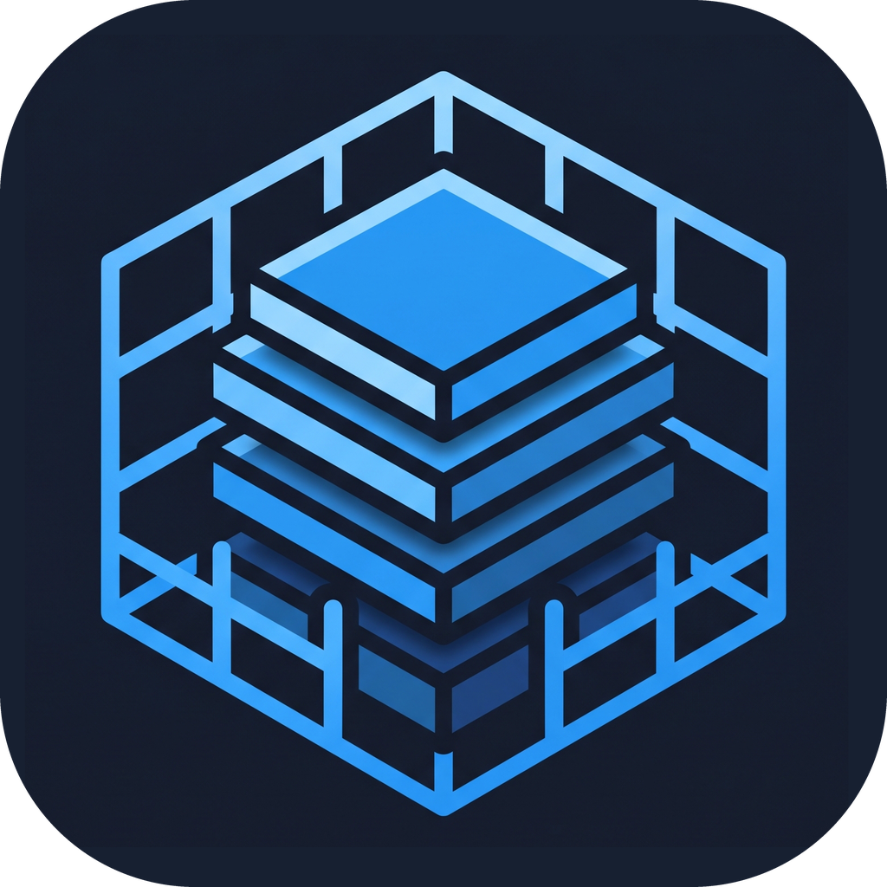

<p align="center">
  
</p>

<h1 align="center">Stackyard</h1>

<p align="center">
  Your local development environment in one desktop app — web servers, runtimes, databases, and admin panels, installed and started with a click.
</p>

<p align="center">
  <a href="https://github.com/pipsyrs/stackyard/releases/latest"></a>
  <a href="LICENSE"></a>
  
</p>

Stackyard runs on Windows, macOS, and Linux. It is free and open source under the [MIT License](#license).

## Contents

- [Features](#features)
- [Available modules](#available-modules)
- [Install](#install)
- [Using Stackyard](#using-stackyard)
  - [Projects and `.test` domains](#projects-and-test-domains)
  - [Built-in terminal](#built-in-terminal)
  - [Node.js and Python in your own terminal](#nodejs-and-python-in-your-own-terminal)
  - [Database panels](#database-panels)
- [Updates](#updates)
- [Your data](#your-data)
- [License](#license)

## Features

- **Module Hub**: browse, search, and install web servers, runtimes, databases, and panels. Several versions of the same module can live side by side.
- **Verified downloads**: every module is checked against a signed list before it is installed, and interrupted downloads resume where they stopped.
- **One-click services**: start, stop, or restart one service or all of them, see their status live, and let crashed services restart on their own. Services can start automatically when the app opens.
- **No port fights**: Stackyard warns when a port is taken and suggests a free one. Every service listens on your own computer only.
- **Projects on `.test` domains**: every folder in your projects folder opens at `<folder>.test`, with a PHP version per project and optional local HTTPS.
- **Built-in terminal**: tabs with every installed tool (`node`, `php`, `mysql`, `psql`, `redis-cli`, …) ready to use.
- **Logs**: filter and follow the output of every service.
- **System tray**: closing the window keeps your services running; quit from the tray icon to stop them all.
- **Automatic updates** with a list of what changed, shown in your language.
- **English and Indonesian** interface, with light, dark, and system themes.

## Available modules

| Module | Category | Versions | Platforms |
|---|---|---|---|
| nginx | Web server | 1.30 | Windows, macOS, Linux |
| Apache HTTP Server | Web server | 2.4 | Windows, macOS, Linux¹ |
| PHP | Runtime | 8.4, 8.3 | Windows, macOS, Linux |
| Node.js | Runtime | 26 LTS, 24 LTS | Windows, macOS, Linux |
| Python | Runtime | 3.15, 3.14 | Windows, macOS, Linux |
| MySQL | Database | 8.4 LTS | Windows, macOS 15+, Linux x64 |
| MariaDB | Database | 12.3 LTS, 11.8 LTS | Windows, Linux x64 |
| PostgreSQL | Database | 18, 17 | Windows, macOS, Linux |
| MongoDB | Database | 9.0, 8.0 (with `mongosh`) | Windows, macOS, Linux (Ubuntu 22.04+ or similar) |
| Redis | Database | 8.10 | Windows, macOS, Linux¹ |
| phpMyAdmin (for MySQL & MariaDB) | Panel | 5.2 | Windows, macOS, Linux |
| pgAdmin 4 (for PostgreSQL) | Panel | 9 | Windows, macOS (Apple Silicon), Linux |

¹ On macOS and Linux, a new Apache or Redis version can appear a little later than on Windows.

**Default ports**: nginx 80, Apache 82, phpMyAdmin 8081, pgAdmin 5050, PHP 9000, MySQL 3306, MariaDB 3307, PostgreSQL 5432, MongoDB 27017, Redis 6379. On macOS and Linux, ports below 1024 move up by 8000 (nginx uses 8080, Apache 8082). Every port can be changed on the Services page.

**Database passwords**: MySQL, MariaDB, and PostgreSQL get a random root password on first start, stored in your system keychain. Find it under **Credentials** on the Services page. MongoDB and Redis run without a password, as they do by default, and are only reachable from your own computer.

On Windows, Apache needs the [Visual C++ Redistributable](https://learn.microsoft.com/cpp/windows/latest-supported-vc-redist).

## Install

Download the installer for your system from the [Releases page](https://github.com/pipsyrs/stackyard/releases/latest):

| System | File | How to install |
|---|---|---|
| Windows | `Stackyard_<version>_x64-setup.exe` (or `.msi`) | Run it |
| macOS | `Stackyard_<version>_universal.dmg` | Open it and drag Stackyard into Applications |
| Debian / Ubuntu | `Stackyard_<version>_amd64.deb` | `sudo apt install ./Stackyard_<version>_amd64.deb` |
| Fedora / RHEL / openSUSE | `Stackyard-<version>-1.x86_64.rpm` | `sudo dnf install ./Stackyard-<version>-1.x86_64.rpm` |
| Any Linux | `Stackyard_<version>_amd64.AppImage` | `chmod +x Stackyard_*.AppImage && ./Stackyard_*.AppImage` |

> The installers are not yet signed with an OS certificate. On **Windows**, SmartScreen may say "Windows protected your PC": click **More info → Run anyway**. On **macOS**, the first launch is blocked: right-click the app and choose **Open**, or run `xattr -cr /Applications/Stackyard.app`.

## Using Stackyard

### Projects and `.test` domains

Every folder in `~/Stackyard/www` is a project that opens at `<folder>.test`. Create one with **Projects → New project**, or simply add a folder there (lowercase letters, digits, and dashes). If the folder has a `public/` subfolder, as in Laravel or Symfony, that becomes the site root.

- **Domains**: click **Register domains** and confirm the administrator prompt once. Stackyard adds the `.test` names to your hosts file and leaves everything else in it untouched.
- **PHP per project**: pick a PHP version on each project card. Stackyard starts that version together with the web server.
- **HTTPS**: click **Enable HTTPS** and confirm once. Your projects then also open over `https://`. The certificate only works for `.test` and local addresses, so it cannot be misused for other websites. On Linux, install `libnss3-tools` (or `nss-tools`) so Chrome and Firefox trust it too.
- **Ports on macOS and Linux**: projects open at `http://<folder>.test:8080/`. On Linux, **Use ports 80/443** lets you drop the `:8080`.

### Built-in terminal

**Terminal** opens tabs with your usual shell, in your projects folder or straight in one project (**Terminal** on a project card). Every installed tool is ready to use without any setup. Copy with <kbd>Ctrl</kbd>+<kbd>Shift</kbd>+<kbd>C</kbd> and paste with <kbd>Ctrl</kbd>+<kbd>Shift</kbd>+<kbd>V</kbd>.

### Node.js and Python in your own terminal

The first Node.js or Python version you install becomes the **default**; change it with **Make default** in the Module Hub. To use `node`, `npm`, `python`, or `pip` from any terminal, add Stackyard's folder to your `PATH` once. **Settings → Terminal (PATH)** shows a ready-to-copy line, for example:

```bash
export PATH="$HOME/Stackyard/bin:$PATH"          # bash/zsh: add to ~/.bashrc or ~/.zshrc
```

### Database panels

phpMyAdmin (for MySQL and MariaDB) and pgAdmin (for PostgreSQL) are included and kept up to date automatically. While a database is running, its card shows an **Open** button that opens the panel in your browser. Log in with the user and password from **Credentials**. The first pgAdmin download takes a few minutes.

## Updates

Stackyard checks for a new version when it starts (you can turn this off in **Settings**). Before updating it shows what changed, and after updating it shows "What's new" once. The full history is in **Settings → Changelog**, and in [`CHANGELOG.en.md`](CHANGELOG.en.md) (English) and [`CHANGELOG.md`](CHANGELOG.md) (Indonesian).

## Your data

Everything Stackyard installs and stores lives in one folder, `~/Stackyard/`. Your projects are in `~/Stackyard/www`.

## License

Stackyard is released under the [MIT License](LICENSE). You may use, copy, modify, and share it, including for commercial work, as long as you keep the copyright notice and license text.
